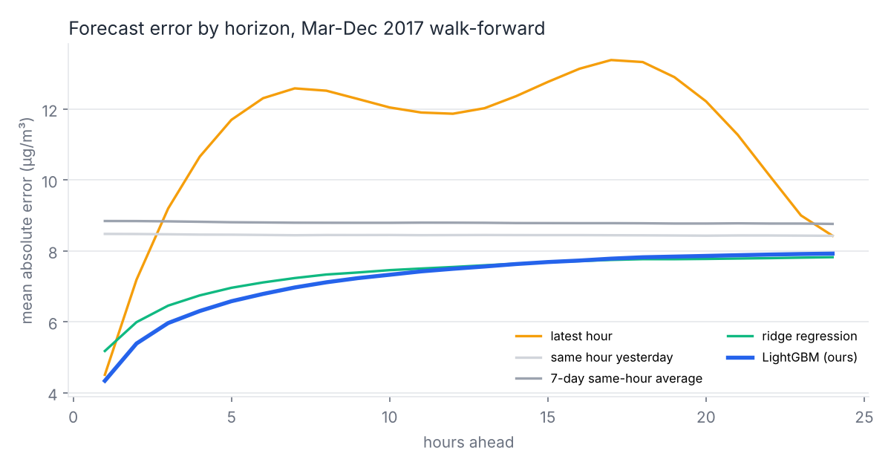
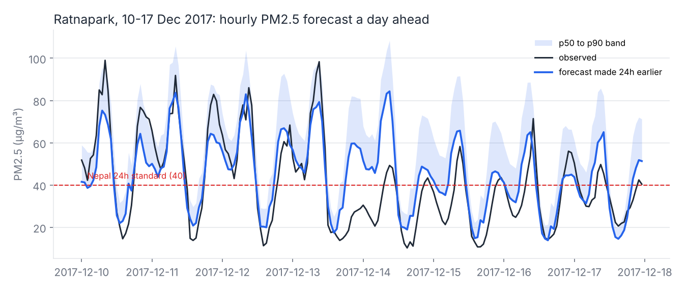
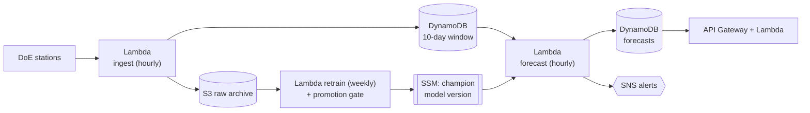

# Hawa (हावा): hour-by-hour air-quality forecasts for the Kathmandu Valley

[](https://hawa-kathmandu-air.onrender.com)

Hawa forecasts PM2.5 for each of the next 24 hours at the Kathmandu Valley's government monitoring stations, warns when the next day is likely to break Nepal's air-quality standard, and tells people which hours will be cleanest. It is built on real Department of Environment sensor data, backtested month by month, and designed to run on AWS for about **$2.60 a month**.

```text
GET /forecast/ratnapark/alert

Hawa air alert (Ratnapark): PM2.5 next 24h ~45 ug/m3, national limit 40. Exceedance LIKELY.
Cleanest hours: 13:00, 14:00, 15:00. Limit outdoor exercise; wear an N95 outdoors.

हावा सूचना (रत्नपार्क): आगामी २४ घण्टा PM2.5 करिब 45, राष्ट्रिय मापदण्ड 40। मापदण्ड नाघ्ने धेरै सम्भावित।
सफा समय: 13:00, 14:00, 15:00। बाहिर व्यायाम कम गर्नुहोस्, N95 मास्क लगाउनुहोस्।
```
*(Real output of the replay for 7 December 2017, 23:00.)*

## The problem

Every winter and spring the Kathmandu Valley's air turns hazardous. The valley is a bowl: at night a temperature inversion puts a lid on it, trapping smoke from traffic, brick kilns and burning rubbish until mid-morning. Nepal's 24-hour standard for PM2.5 is 40 µg/m³ (WHO's guideline is 15). In this data, the Ratnapark station in central Kathmandu averaged 84 µg/m³ in January 2017.

Monitoring stations publish what the air *was* an hour ago. Nobody tells a parent at 18:00 whether tomorrow morning's walk to school will be in the worst air of the day, or whether waiting until the afternoon dip helps. That is a forecasting problem, and a small, well-run model can answer it.

## Results

Walk-forward backtest, March to December 2017: for each month, train only on what was known before it, then forecast every hour of the month, 1 to 24 hours ahead, at both stations (283,078 forecasts).

| Forecast for each of the next 24 hours | MAE (µg/m³) |
|---|---:|
| Latest hour, repeated | 11.23 |
| Same hour yesterday | 8.45 |
| 7-day average for that hour | 8.79 |
| Damped-anomaly persistence (statistics, no training) | 7.51 |
| Ridge regression | 7.32 |
| **LightGBM (Hawa)** | **7.18** |

**15% lower error than the best naive forecast**, and the p90 forecast is calibrated: 90.3% of outcomes fell at or below it.



**The alert is where the model earns its keep.** For "will the next 24 hours exceed 40 µg/m³" (2,822 exceedances in 13,028 forecasts):

| Alert rule | Missed exceedances | False alarms | Recall | Precision |
|---|---:|---:|---:|---:|
| Last 24 hours were above 40 (persistence) | 537 | 572 | 81.0% | 80.0% |
| **Hawa p50 above 40 ("likely")** | **324** | **583** | **88.5%** | **81.1%** |
| Hawa p90 above 40 ("possible") | 15 | 3,039 | 99.5% | 48.0% |

**40% fewer missed bad-air days than persistence, with about the same number of false alarms.**



### What I'd tell an interviewer about these numbers

- **Most of the gain comes from a one-line statistical anchor, not from LightGBM.** Damped-anomaly persistence ("today's deviation from normal, fading with horizon") gets MAE 7.51 with no training; LightGBM adds about 4% on top. I kept both in the table because hiding that would be misleading.
- **I tuned hyperparameters on 4 of the 10 months.** On the 6 months I didn't touch, LightGBM *ties* ridge and the anchor (MAE 6.72) and beats the best naive baseline by 12%. Details in [bug #10](docs/CHALLENGES_AND_BUGS.md#10-i-tuned-on-the-test-months-so-i-report-both).
- **The ceiling is the inputs, not the model.** With two PM2.5 sensors and no weather, the biggest misses are clean-ups after a weather change (13-14 December in the chart above). Weather data is the next feature, not a bigger model.

## Architecture



Serverless and event-driven because the workload is tiny and bursty: two readings an hour, two forecasts an hour, read traffic that spikes on bad-air days. Forecasts are computed in batch and stored, so the API is a key-value read and there is no model server to keep warm. Full diagram and reasoning: **[docs/ARCHITECTURE.md](docs/ARCHITECTURE.md)**.

## Engineering documents

| Document | What's in it |
|---|---|
| [Architecture](docs/ARCHITECTURE.md) | AWS and local diagrams, why each component exists, how it scales at 10x and 100x, how to go live |
| [Alternatives considered](docs/ALTERNATIVES.md) | 8 decision records: which problem, what to predict, model choice, SageMaker vs Lambda, batch vs real-time, orchestration, IaC, alert channel |
| [What breaks](docs/FAILURE_MODES.md) | 15 failure modes with detection and response, and a **measured** sensor-outage experiment |
| [Cost](docs/COST.md) | Itemised monthly estimate, comparison with EC2 and SageMaker designs, and 11 cost decisions in the code |
| [Challenges and bugs](docs/CHALLENGES_AND_BUGS.md) | 15 real problems hit while building this, with evidence and fixes |
| [Model card](docs/MODEL_CARD.md) | Intended use, limitations, and who the errors affect |

## How it maps to the AWS Well-Architected pillars

| Pillar | In this project |
|---|---|
| Operational excellence | Everything in IaC (SAM); structured logs; alarms on *freshness* (a job that silently stops running), not only on errors; one-string model rollback |
| Security | Least-privilege IAM per function (SAM policy templates); S3 encrypted and public access blocked; no secrets in code; containers run as non-root locally |
| Reliability | Retries and a dead-letter queue on every schedule; neighbour-station fallback measured under a simulated outage; promotion gate on retraining; refuses to forecast rather than inventing numbers |
| Performance efficiency | Batch inference; model cached across warm Lambda starts; one DynamoDB query loads the hot window |
| Cost optimisation | Scales to zero; Graviton; HTTP API; on-demand DynamoDB with TTL; budget alarm. About $2.60/month |
| Sustainability | No idle compute; 4-leaf trees trained on every 3rd hour; the smallest model that matched bigger ones |

## Try it live

**[https://hawa-kathmandu-air.onrender.com](https://hawa-kathmandu-air.onrender.com)**

Pick an hour and a station and see the next 24 hours of PM2.5 forecast, the bilingual alert, and what the sensor actually measured.

It runs on a free server that sleeps when nobody is using it, so the first visit can take a minute to wake up. Everything runs offline: no API keys, no cloud account.

To run the same page locally: `pip install -r requirements-app.txt` and then `streamlit run app.py`.

## Run it

**With Python 3.12+:**

```bash
make setup && source .venv/bin/activate
make quality     # download raw data (checksummed) and print the data-quality report
make backtest    # walk-forward backtest; writes artifacts/reports and the charts in docs/img (~5 min)
make train       # train on data up to 1 Dec 2017, with the promotion gate
make replay      # run the hourly job for 1-7 Dec 2017 as if it were live
make serve       # API on http://localhost:8000  (try /forecast/ratnapark and /docs)
make test        # 18 tests, including the Lambda handlers against mocked AWS
```

**With Docker:**

```bash
docker compose run --rm pipeline   # download, quality report, train, replay a week
docker compose up api              # http://localhost:8000/forecast/ratnapark
```

**On AWS:** see [infra/README.md](infra/README.md) (`sam build && sam deploy --guided`, then one seed script).

## Repository layout

```text
hawa/
  data.py         download (pinned + checksummed), parse, clean: every rule traced to a real fault
  features.py     leakage-safe features; damped-anomaly anchor
  models.py       baselines, ridge, LightGBM p50/p90/neighbour models
  backtest.py     walk-forward evaluation, alert metrics, sensor-outage experiment
  forecast.py     inference with the fallback chain (primary -> neighbour -> refuse)
  pipeline.py     hourly job, replay, retrain with promotion gate
  alerts.py       English and Nepali alert messages
  api.py          FastAPI (local); same routes on Lambda in aws/handlers.py
  store.py        LocalStore and DynamoStore behind one interface
  aws/handlers.py Lambda entry points: ingest, forecast, retrain, api
infra/            SAM template, Lambda Dockerfile, deploy guide
scripts/          AWS seeding, cost model
tests/            data rules, leakage, purge, fallback, API, Lambda handlers on moto
docs/             the engineering documents above
```

## Data and credits

PM2.5 measurements: Government of Nepal, Ministry of Forests and Environment, Department of Environment, Air Quality Monitoring ([pollution.gov.np](http://pollution.gov.np)), via the public mirror [hbvj99/NPGovAirPollution](https://github.com/hbvj99/NPGovAirPollution) pinned to a commit and verified by SHA-256. See [data/README.md](data/README.md).

Nepal's National Ambient Air Quality Standard (2012) sets the 24-hour PM2.5 limit at 40 µg/m³.

## License

MIT. The data remains under its source's terms.
