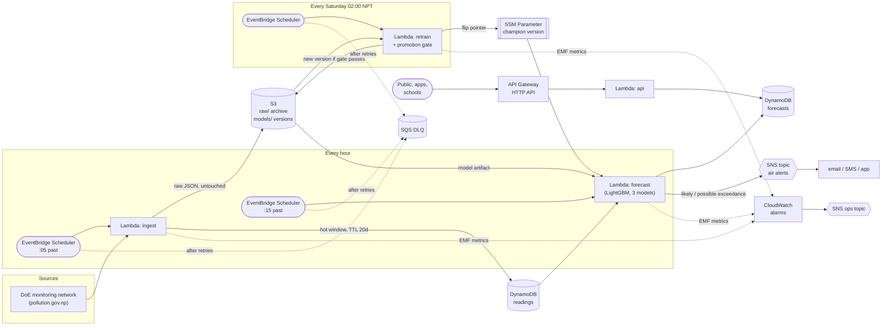
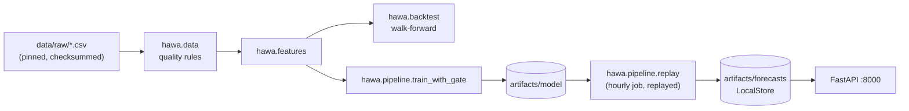

# Architecture

## The shape of the problem

Before choosing services I wrote down what the workload actually is, because that decides almost everything:

| Property | Value | Consequence |
|---|---|---|
| Data rate | 2 stations x 1 reading per hour | Tiny. No streaming system needed. |
| Prediction rate | 2 forecasts per hour (24 hourly values each) | Batch, not real time. No always-on model server. |
| Read traffic | Spiky: mornings, and bad-air days when the news covers it | Must scale up without capacity planning, and to zero at night. |
| Training data | ~20k station-hours per year | Trains in a minute on one machine. No distributed training. |
| Freshness | A forecast older than ~2 hours is misleading | Monitor the *age* of the latest forecast, not just errors. |
| Failure cost | A missed bad-air day is worse than a false alarm | Alert on p90 as well as p50; never silently skip a station. |

Those six rows are why this is serverless and event-driven, with no SageMaker endpoint and no Kinesis.

## AWS deployment

Everything is in [`infra/template.yaml`](../infra/template.yaml) (AWS SAM). One container image serves all four functions; `ImageConfig.Command` picks the handler.

### Why each piece is there

**Ingest and forecast are separate functions, ten minutes apart.** Ingest talks to an external system that will be slow or down sometimes; forecast should not inherit that. Separating them means a failed ingest retries on its own, and the forecast still runs with whatever data exists (the fallback chain handles the gap). It also keeps the raw archive write path free of model code.

**Raw data goes to S3 untouched, -999s included.** The cleaning rules changed several times while building this (see [CHALLENGES_AND_BUGS.md](CHALLENGES_AND_BUGS.md)). If the archive held cleaned data, every rule change would need the source to resend history, which a government feed will not do. S3 is the source of truth for retraining; DynamoDB is only a 10-day hot window with TTL.

**DynamoDB for the hot window, not S3.** The forecast needs the last 240 hours per station every hour. One DynamoDB `Query` on `station` + `ts BETWEEN` returns that in one round trip; the same from S3 is 480 GETs.

**The model version is a pointer in SSM Parameter Store.** Models live at `s3://.../models/<version>/`. The forecaster reads the pointer, so a rollback is changing one string, and it is cached across warm invocations so the S3 download happens once per container, not once per hour.

**Retraining has a promotion gate.** The candidate is trained without the last 30 days, scored on them, and promoted only if it beats both the weekly-profile baseline and the current champion (within 2%). Otherwise the old model keeps serving and the `RetrainGatePassed` alarm fires. A retrain on a week of bad sensor data is the most likely way this system would degrade silently; the gate makes it loud.

**ReservedConcurrency = 1 on the forecaster.** A retried run from the previous hour must not race the current one and overwrite a newer forecast with an older one.

**Observability is about freshness.** The two alarms that matter most are "forecast job errored twice in a row" and "forecast job has not *run* for three hours" (the second catches a disabled schedule, which produces no errors at all). `/health` returns `ok: false` when any station's forecast is missing.

## Local deployment (what runs in this repo today)

The local path and the Lambda path call the same functions (`hawa.pipeline.run_hour`, `train_with_gate`, `hawa.forecast.forecast`); only the storage adapter differs (`LocalStore` vs `DynamoStore`). `tests/test_aws_handlers.py` runs the real Lambda handlers against mocked S3, DynamoDB, SNS and SSM (moto) to prove the cloud wiring without an AWS account.

## Going live

The system currently replays the 2016-17 DoE files (`REPLAY_OFFSET_DAYS` shifts "now" into that period). To go live, replace `_replay_readings()` in [`hawa/aws/handlers.py`](../hawa/aws/handlers.py) with a client for a live feed that returns the same five columns (`station, ts, max, min, average`):

- **DoE (pollution.gov.np)**: the original source of this data (the mirror's author scraped it from the station pages).
- **OpenAQ v3**: aggregates Nepal's stations behind one documented API (needs a free key, which would go in Secrets Manager).

I have not built either client, because the build environment had no network route to them and I didn't want to ship code I couldn't run. Everything downstream of that function is tested.

## Scaling: what changes at 10x and 100x

| Scale | What breaks first | Change |
|---|---|---|
| 20 stations (all of Nepal's network) | Nothing. One forecast run does 20 stations in seconds. | `STATIONS` grows; consider one model across all stations with station features (already the design). |
| A few years of archive | The weekly retrain lists and reads one S3 object per station-hour (~17k/year/station). | Add a nightly compaction job writing one Parquet file per day, and read those. |
| 200+ stations or sub-hourly data | Single-Lambda forecasting and 15-minute timeout for training. | Step Functions Map state to fan out per station group; SageMaker training jobs for retraining. |
| Public app with heavy reads | API Lambda cold starts (pandas in the image). | Put CloudFront in front (forecasts change hourly, cache 5 minutes), or split a slim API image without pandas. |
